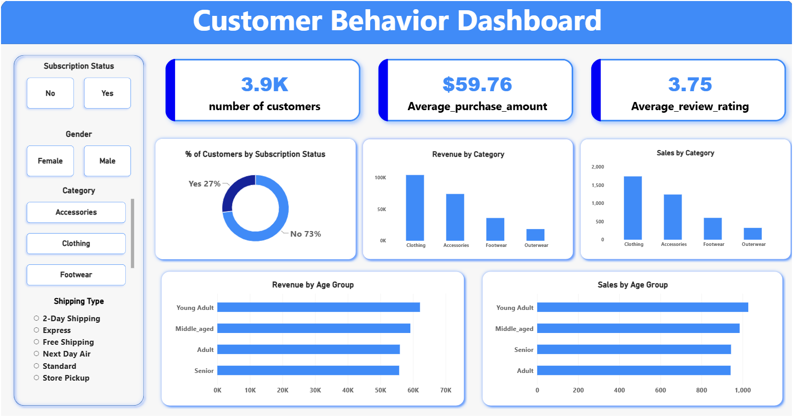

## 📌 Project Overview

This project analyzes **3,900 customer shopping records** to understand _who buys, what they buy, how much they spend, and what drives repeat purchases_ for a retail business.

The work is done end to end:

1. **Python (pandas, Jupyter Notebook)** – data loading, cleaning and feature engineering
2. **MySQL** – business questions answered with SQL queries
3. **Power BI** – an interactive dashboard that presents the findings visually

The goal is to turn raw transaction data into insights that can support decisions on marketing, discounts, subscriptions and product strategy.

---

## 🎯 Objectives

- Clean and prepare the raw customer dataset for analysis
- Create new features (age groups, purchase frequency in days)
- Answer 10 business questions using SQL
- Build an interactive dashboard to explore revenue, customers and ratings

---

## 📂 Repository Structure

```
├── customer_shopping_behavior.csv      # Raw dataset (3,900 rows, 18 columns)
├── Customer_Behavior_analysis.ipynb    # Jupyter notebook: cleaning + feature engineering
├── Shopping_Behavior.sql               # 10 business questions
├── Customer_Behavior_Dashboard.pbix    # Power BI dashboard
└── README.md
```

---

## 🗂️ Dataset

| Detail         | Value                 |
| -------------- | --------------------- |
| Rows           | 3,900                 |
| Columns        | 18                    |
| Missing values | 37 in `Review Rating` |

**Source**:


**Key columns:** Customer ID, Age, Gender, Item Purchased, Category, Purchase Amount (USD), Location, Size, Color, Season, Review Rating, Subscription Status, Shipping Type, Discount Applied, Promo Code Used, Previous Purchases, Payment Method, Frequency of Purchases.

---

## 🧹 Data Cleaning & Feature Engineering (Python)

Done in the Jupyter notebook with **pandas**:

- **Explored** the data with `info()`, `describe()`, `head()`, `tail()`, `shape`, `dtypes`
- **Handled missing values:** the 37 missing `Review Rating` values were filled with the **median rating of each product category** (more reliable than one global value)
- **Standardized column names** to `snake_case` (e.g. `Purchase Amount (USD)` → `purchase_amount`)
- **Created `age_group`:** customers split into 4 equal-sized groups (Young Adult, Adult, Middle_aged, Senior) using `pd.qcut`
- **Created `purchase_frequency_days`:** converted text frequencies (Weekly, Fortnightly, Monthly, Quarterly, Annually...) into number of days
- **Removed redundant column:** `promo_code_used` was dropped after confirming it is identical to `discount_applied`
- **Loaded into MySQL** using SQLAlchemy and PyMySQL (`df.to_sql`) so the data could be queried with SQL

---

## 🗄️ SQL Analysis (MySQL)

The cleaned table is queried in `Shopping_Behavior.sql`. Concepts used: `GROUP BY`, aggregate functions, subqueries, `CASE WHEN`, CTEs and window functions (`ROW_NUMBER() OVER (PARTITION BY ...)`).

| #   | Business Question                                                            |
| --- | ---------------------------------------------------------------------------- |
| 1   | Revenue generated by male vs female customers                                |
| 2   | Customers who used a discount but still spent more than the average purchase |
| 3   | Top 5 products with the highest average review rating                        |
| 4   | Average purchase amount: Standard vs Express shipping                        |
| 5   | Do subscribers spend more? (average spend and total revenue)                 |
| 6   | Top 5 products with the highest percentage of discounted purchases           |
| 7   | Customer segments: New, Returning, Loyal                                     |
| 8   | Top 3 most purchased products within each category                           |
| 9   | Are repeat buyers (more than 5 previous purchases) likely to subscribe?      |
| 10  | Revenue contribution of each age group                                       |

---

## 📊 Power BI Dashboard

The dashboard (`Customer_Behavior_Dashboard.pbix`) includes:

- **KPI cards:** number of customers, average purchase amount, average review rating
- **Revenue by Category** and **Sales by Category**
- **Revenue by Age Group** and **Sales by Age Group**
- **% of Customers by Subscription Status** (donut chart)
- **Interactive filters:** Gender, Category, Subscription Status, Shipping Type

> 

---

## 🔍 Key Insights

- **Total revenue is about $233K** across 3,900 customers, with an average purchase of about **$59.76** and an average rating of **3.75 / 5**.
- **Male customers generate about 68% of revenue** ($157.9K vs $75.2K for female customers).
- **Clothing is the top category** (about $104K, roughly 45% of revenue), followed by Accessories, Footwear and Outerwear.
- **Subscribers do not spend more per purchase** (about $59.49 vs $59.87 for non-subscribers). Only 27% of customers are subscribed, so there is room to grow subscriptions.
- **Most customers are loyal:** about 80% have more than 10 previous purchases, and only 83 customers are new.
- **Young Adults contribute the most revenue** among the four age groups, although the gap between groups is small.
- **Discounts are used in about 43% of purchases**, with products such as Hat, Sneakers and Coat having discount rates close to 50%.
- **Top-rated products:** Gloves, Sandals, Boots, Hat and Skirt (about 3.8 to 3.9 average rating).

---

## 🛠️ Tools & Technologies

- **Python:** pandas, SQLAlchemy, PyMySQL
- **Jupyter Notebook**
- **MySQL / MySQL Workbench**
- **Power BI**
- **Git & GitHub**

---

## 🚀 How to Run This Project

1. **Clone the repository**
   ```bash
   git clone https://github.com/KattaAnjaneyulu/Customer_Shopping_Behavior_Analysis.git
   cd Customer_Shopping_Behavior_Analysis
   ```
2. **Install the requirements**
   ```bash
   pip install pandas sqlalchemy pymysql jupyter
   ```
3. **Open the notebook** and run all cells to clean the data
   ```bash
   jupyter notebook
   ```
4. **Create a MySQL database** named `shopping_behavior`, then set your own MySQL username and password in the notebook connection cell. The notebook loads the cleaned data into a table called `mytable`.
5. **Run `Shopping_Behavior.sql`** in MySQL Workbench to reproduce the analysis.
6. **Open `Customer_Behavior_Dashboard.pbix`** in Power BI Desktop to explore the dashboard.

---

## ✅ Conclusion

This project shows a complete data analyst workflow: cleaning data in Python, answering business questions in SQL and presenting results in Power BI. The main takeaways are that Clothing and male customers drive most revenue, subscriptions are not yet increasing spend, and the customer base is highly loyal, which points to opportunities in subscription growth and targeted discounting.

---

## 👤 Author

### **Katta Anjaneyulu**

🎓 MSc Data Science Graduate | Osmania University

📍 Hyderabad, India

🎯 Aspiring Data Analyst / Data Scientist

🗄️ SQL &nbsp;|&nbsp; 📊 Power BI &nbsp;|&nbsp; 📗 Excel &nbsp;|&nbsp; 🐍 Python

🔗 **Connect with me**

- [💼 LinkedIn](https://www.linkedin.com/in/kattaanjaneyulu)
- [🐙 GitHub](https://github.com/KattaAnjaneyulu)
- [📧 Email](https://mail.google.com/mail/?view=cm&to=kattaanjaneyulu.k@gmail.com)
